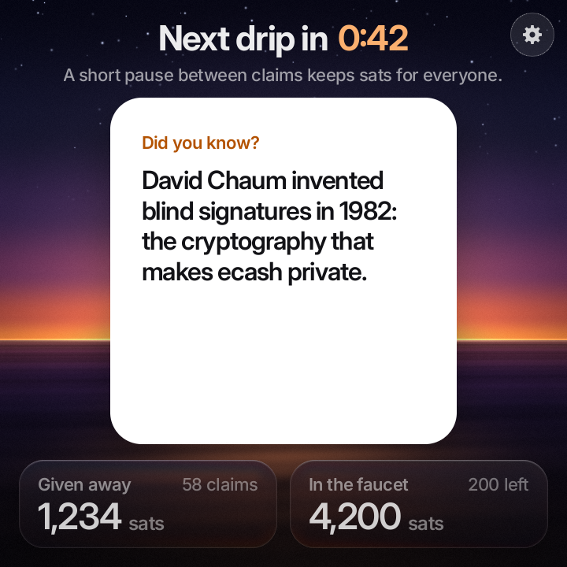
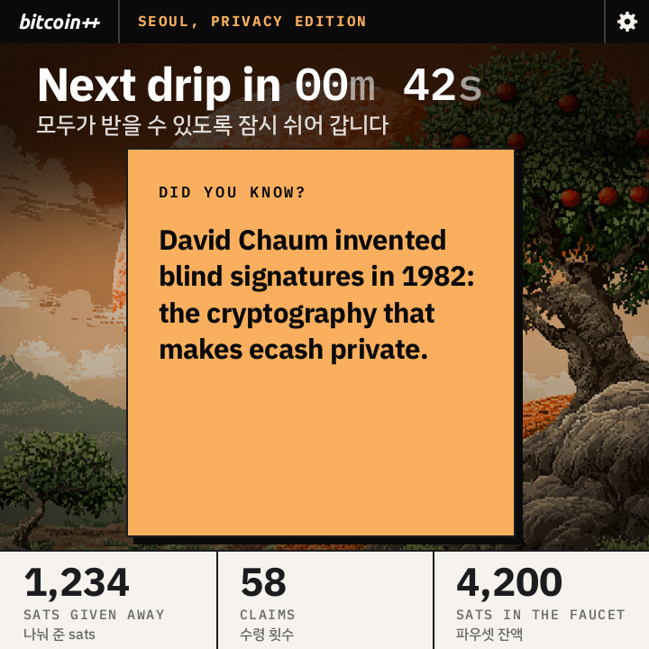
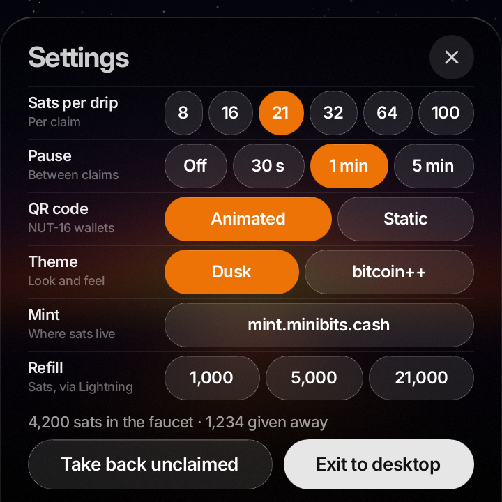

# Cashu Pixel

A Cashu ecash faucet that sits on a table. A Raspberry Pi Zero 2 W drives a 720×720 touchscreen that always shows one ecash token as a QR code. Scan it with a Cashu wallet and the sats are yours. A minute later, the next token appears.

It's written in Rust, with [CDK](https://github.com/cashubtc/cdk) for the wallet and [Slint](https://slint.dev) for the screen, drawn by Slint's software renderer.

| Claim | Pause | Refill |
|:-:|:-:|:-:|
|  |  |  |
| **bitcoin++ Seoul** | **bitcoin++ Seoul, pause** | **Settings** |
|  |  |  |

## How it works

- **One token at a time,** 21 sats by default. When a wallet claims it, the screen says so, then pauses for a minute so one person can't empty the faucet. During the pause the card shows Cashu trivia and the countdown runs in the headline.
- **Refills over Lightning.** When the balance drops below one drip, the screen shows a Lightning invoice that anyone can pay.
- **Its own wallet.** The seed, `wallet.db` and `faucet.json` (settings, stats, the token on screen) live in `~/.local/share/pixel-faucet` on the Pi. The token on screen survives a restart, and tokens that were made but never shown are taken back at startup.
- **Any mint.** Minibits until you pick another under Settings › Mint. The choices are in [`src/known-mints.txt`](src/known-mints.txt), plus any you list one per line in `~/.local/share/pixel-faucet/mints.txt`. Switching checks the new mint, takes back the token on screen and moves the sats over Lightning. If that payment fails, the faucet stays where it was.
- **Settings** are behind the gear at the top right: sats per drip, the pause (off, 30 s, 1 min or 5 min), animated or static QR, theme, mint, refill, take back unclaimed tokens, and exit to the desktop.
- **Two themes:** Dusk, the faucet's own look, and bitcoin++ Seoul, styled after [btcpp.dev/seoul](https://btcpp.dev/seoul) in English and Korean.

A few details that matter for wallets:

- Tokens leave out their DLEQ proofs, which nearly halves their length. The faucet encodes tokens itself, because CDK writes the missing proof as `null` and Macadamia rejects the token when it does.
- Tokens over 300 characters are shown as an animated QR code (NUT-16), about 49×49 modules a frame at 5 frames a second. Settings can switch to one static QR code for wallets without NUT-16.
- QR codes are rendered in Rust at their exact size on screen and drawn 1:1, since Slint's software renderer drops rows and columns when it scales an image by a non-whole factor.

## Hardware

- Raspberry Pi Zero 2 W with a 40-pin header (the Zero 2 WH comes with one soldered on)
- Pimoroni HyperPixel 4.0 Square Touch, 720×720
- microSD card, 16 GB or larger
- 5 V micro-USB power supply for the Pi, 2.5 A

The display plugs straight onto the Pi's header, and the Pi sits behind it. The faucet needs Wi-Fi to reach its mint.

## Set up the Pi

1. Flash **Raspberry Pi OS (64-bit) with the desktop** to the card with [Raspberry Pi Imager](https://www.raspberrypi.com/software/). Pick Raspberry Pi Zero 2 W as the device, and in the customisation step set a user, your Wi-Fi and SSH. The faucet is an arm64 program, so it needs the 64-bit OS. It runs on Debian 13 (trixie).
2. Before the first boot, open `config.txt` on the card's boot partition (it's `/boot/firmware/config.txt` once the Pi is running) and add this line at the end:
   ```
   dtoverlay=vc4-kms-dpi-hyperpixel4sq
   ```
   Leave I2C and SPI off, as they are by default.
3. Press the display onto the Pi's header, put the card in and plug in power. The desktop comes up on the square screen, and touch works.

## Build

The faucet is compiled for arm64 in Docker. That's native on Apple silicon; on an x86 machine Docker emulates arm64, which works but is much slower.

Build the image once:

```sh
docker build --platform linux/arm64 -t pixel-faucet-build .
```

Then build the faucet:

```sh
docker run --rm --platform linux/arm64 \
  -v pixel-faucet-target:/app/target -v pixel-faucet-cargo:/usr/local/cargo/registry -v "$PWD":/app \
  pixel-faucet-build sh -c 'cargo build --release --locked && cp target/release/pixel-faucet pixel-faucet-arm64'
```

The two volumes keep the build cache and the downloaded crates between runs. A first build takes about 6 minutes on an Apple silicon Mac; later ones only rebuild what changed. The result is `pixel-faucet-arm64` in the repo folder.

The tests (token encoding, animated frames, QR rendering) run in the same container with `cargo test --release --locked`. Add `-- --ignored` to also check every mint in the list over the network.

## Install on the Pi

Copy the program and the `deploy/` folder to the Pi, then run the installer there. With the user and hostname you set in Imager:

```sh
scp -r pixel-faucet-arm64 deploy pi@cashu-pixel.local:
ssh -t pi@cashu-pixel.local ./deploy/install.sh ./pixel-faucet-arm64
```

This adds Pixel Faucet to the app menu, the desktop and the taskbar. It opens fullscreen. With no desktop running, it draws straight to the display instead. Its log is `~/.cache/pixel-faucet.log`.

## Fill it

A new faucet is empty, so it opens on the refill screen: a Lightning invoice for 1,000 sats. Pay it from any Lightning wallet, and the first token appears. To add more later, use Settings › Refill.

## Screenshots

`pixel-faucet --snapshot <dir>` renders every screen with sample data to PNG files. It uses the same software renderer as the device and doesn't touch the wallet, so it runs in the build container:

```sh
docker run --rm --platform linux/arm64 \
  -v pixel-faucet-target:/app/target -v pixel-faucet-cargo:/usr/local/cargo/registry -v "$PWD":/app \
  pixel-faucet-build ./target/release/pixel-faucet --snapshot snapshots
```

The images at the top are a selection from that run, in `docs/screenshots/`. The QR codes in them aren't real tokens.

## What's where

| Path | Contents |
|---|---|
| `src/main.rs` | The faucet: wallet, tokens, claims, refills, settings |
| `src/mints.rs`, `src/known-mints.txt` | The mints offered under Settings, and the check a new mint must pass |
| `src/backdrop/` | Each theme's background, painted once at startup, since Slint's software renderer can't draw blur, shadows or gradients |
| `src/snapshot.rs` | `--snapshot` |
| `ui/` | The Slint UI: `faucet.slint` is the window, `dusk.slint` and `seoul.slint` the themes, `state.slint` and `common.slint` what they share. Fonts and artwork too |
| `deploy/` | The installer, the launcher, the menu entry and the icon |
| `Dockerfile` | The arm64 build environment |

## Licences

- The code is under the MIT License; see [`LICENSE`](LICENSE). It doesn't cover the fonts or the bitcoin++ artwork below.
- Inter, IBM Plex (including Plex Sans KR) and Source Serif 4 are under the SIL Open Font License, and Ubuntu is under the Ubuntu Font Licence. See `ui/fonts/licenses/`.
- The bitcoin++ name, wordmark, sparkles and persimmon-tree artwork belong to bitcoin++. Get the organisers' OK before showing that theme at their event.
